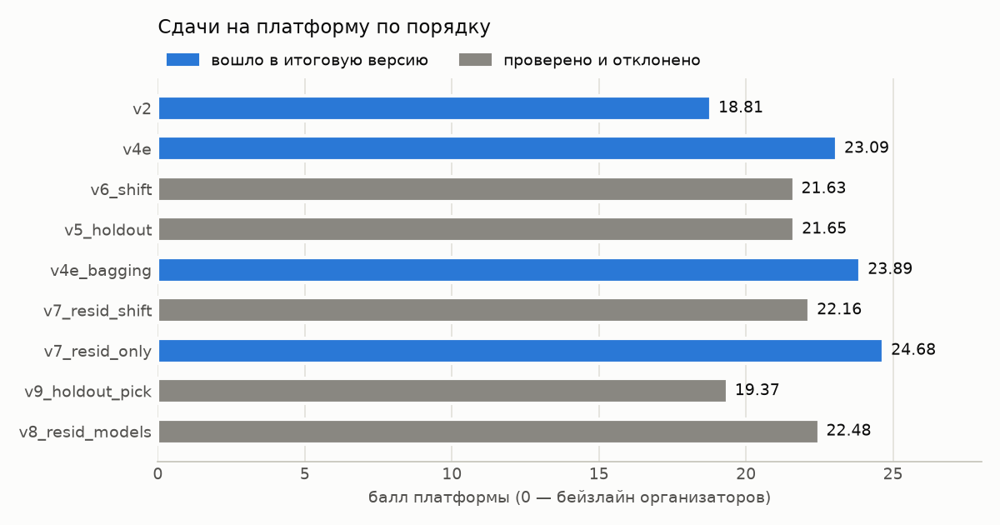
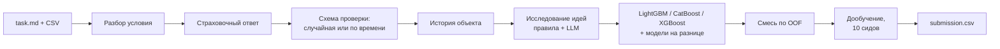

# tabular-automl-agent

AutoML-агент для незнакомых табличных задач: получает папку с `task.md` и CSV и за ограниченное время
сам выбирает схему проверки, признаки и ансамбль градиентных бустингов, после чего пишет `submission.csv`.
Сделан командой на хакатоне Альфа-Банка (трек AutoML, октябрь 2026).

## Результаты

| | Балл платформы |
|---|---|
| Первая рабочая версия (v2) | 18.81 |
| + проверка на будущем периоде и история объекта (v4e) | 23.09 — 29 место из 150 на промежуточном рейтинге |
| + усреднение дообучения по 10 сидам | 23.89 |
| **+ модели на разнице с прошлым значением объекта (этот код)** | **24.68** |

Балл считается относительно бейзлайна организаторов: 0 — уровень бейзлайна, 100 — идеальный ответ.



Из 9 сдач в итоговую версию вошли 4 изменения, 5 гипотез проверено и отклонено. Подробно, со всеми
цифрами и разбором ошибок, — в [docs/results.md](docs/results.md).

## Как работает



- **Надёжность прежде всего.** Константный ответ пишется сразу, через пару минут — ответ LightGBM;
  любая ошибка дальше оставляет на диске предыдущий валидный файл.
- **Проверка как на платформе.** Если тест — будущий период, фолды строятся по времени, а последний
  период train становится отложенной выборкой. Случайные фолды на такой задаче завышают оценку.
- **История объекта.** Агент сам находит колонки, по которым узнаётся тот же объект (здание, клиент),
  и добавляет его ответы из прошлых периодов.
- **LLM предлагает, код решает.** Роли на Qwen (аналитик, исследователь, критик, разработчик) только
  предлагают идеи; данные, фолды, метрику и решение «оставить или откатить» держит код.
  Без ключа агент работает на правилах.

Устройство и обоснование решений — в [docs/architecture.md](docs/architecture.md).

## Быстрый старт

Нужен Python 3.12.

```bash
pip install -r requirements.txt
python polygon/download.py bike_sharing && python -I polygon/build_tasks.py bike_sharing
python agent/scripts/bench.py --tasks bike_sharing --time-limit 300
```

Своя задача (папка с `task.md`, `train.csv`, `test.csv`, `sample_submission.csv`):

```bash
cd path/to/task && python /path/to/tabular-automl-agent/agent/solution.py task.md
```

Тесты: `cd agent && python -m unittest discover -s tests -t .` (124 теста, около 20 минут).
Архив в формате платформы: `python agent/scripts/make_zip.py out.zip`.

## Структура

```
agent/
  solution.py          точка входа: python solution.py task.md
  automl/              ядро: разбор задачи, признаки, проверка, модели, история, смесь
  automl/research/     роли LLM, журнал опытов, клиент OpenAI-совместимого API
  scripts/             замеры на полигоне, сборка архива, репетиция сдачи
  tests/               unittest
polygon/               сборка тестовых задач из открытых данных и подсчёт балла
experiments/           записи замеров (JSON) и сборка таблицы результатов
scripts/experiments/   опыты, по итогам которых принимались решения
docs/                  архитектура, результаты, формат данных
```

## Ограничения

- Баллы — публичный этап на двух задачах; разбивку по задачам платформа не даёт. По диагностической
  сдаче регрессия ≈ 35.6, классификация ≈ 13.8: на классификации тест — другой трафик, и ни одна из
  трёх попыток учесть сдвиг не помогла.
- Локальный полигон оптимистичнее платформы примерно на 9 баллов: на регрессии он верно показывает
  направление изменений, на классификации — нет.
- Данные организаторов не публикуются, поэтому имитации публичных задач (`polygon/build_derived.py`)
  собираются только при наличии исходных файлов. Открытые задачи полигона скачиваются с OpenML.
- Распознавание времени консервативное: числовой столбец периода, минимум четыре периода в train.

## Команда и вклад

Команда из пяти человек.

**Мой вклад:** первая сквозная версия агента и ядро v2 (разбор условия, три семейства моделей,
смесь, страховочный ответ); история объекта и встраивание проверки на будущем периоде (v4);
исправление работы с Qwen (пустые ответы из-за скрытого «размышления»); усреднение дообучения по
сидам; модели на разнице с прошлым значением объекта (v7, лучший результат 24.68); инфраструктура замеров — полигон с имитациями публичных задач, `bench.py`, сборка плоского
архива и «репетиция» сдачи на настоящих файлах, которая нашла две ошибки до отправки; разбор всех
сдач и диагностика по задачам.

**Команда:** Иван — проверка на будущем периоде, дообучение на всех строках, обзор существующих
агентов; Павел — задачи полигона, обработка URL/текста/дат, опыты с бюджетом времени и удалением
сдвинутых признаков; Михаил — справочники для LLM и альтернативные архитектуры исследования;
Егор — изоляция отложенной выборки, командный сервер с моделью.

## Лицензия

[MIT](LICENSE). Сторонние библиотеки и датасеты — в [THIRD_PARTY.md](THIRD_PARTY.md).
