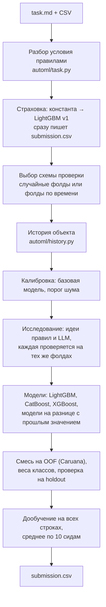

# Архитектура и инженерные решения

Агент получает незнакомую табличную задачу (папка с `task.md` и CSV) и за ограниченное время
пишет `submission.csv`. Условия хакатона: 3 часа на задачу, 8 CPU / 32 ГБ, без интернета,
разрешена одна LLM (Qwen-27B организаторов) через OpenAI-совместимый API, фиксированный список библиотек.

## Поток работы

Бюджет времени (`agent/solution.py`, `agent/automl/pipeline.py`): страховка v1 — не больше
`min(120 с, 10% лимита)`; дальше от старта v2 до мягкого дедлайна исследование занимает до 50%,
модели до 80%, остаток — смесь и дообучение. После `лимит − min(20 мин, 15%)` новые фолды не
начинаются, после `лимит − min(8 мин, 5%)` обучение обрывается.

## Модули

| Модуль | Что делает |
|---|---|
| `agent/solution.py` | Точка входа `python solution.py task.md`: страховка, v1, v2, запись ответа |
| `automl/task.py` | Находит файлы, таргет, тип задачи, метрику, формат ответа — правилами по `task.md` и данным |
| `automl/features.py` | Базовая таблица признаков и декларативные операции над ней (частоты, групповые статистики, даты, URL/текст) |
| `automl/cv.py` | Одна схема проверки на весь прогон, три семейства моделей, OOF-прогнозы, дообучение |
| `automl/history.py` | Поиск ключа объекта и признаки «что этот объект показывал в прошлых периодах» |
| `automl/ensemble.py` | Жадная смесь по OOF (Caruana) и подбор весов классов для label-метрик |
| `automl/pipeline.py` | Оркестрация v2: калибровка, исследование, модели, смесь, дообучение |
| `automl/research/` | Роли LLM (аналитик, исследователь, критик, разработчик), журнал опытов, клиент LLM |
| `automl/guard.py` | Проверка кода признаков, который пишет LLM: AST-ограничения и урезанное пространство имён |
| `automl/shift.py` | EM-поправка долей классов в тесте (выключена по умолчанию, см. результаты) |
| `automl/submission.py` | Константный ответ, проверка формата, атомарная запись |
| `agent/scripts/` | Замеры на полигоне, сборка плоского архива для платформы, «репетиция» сдачи |

## Инженерные решения и почему

**Ответ пишется первым.** Сразу после разбора условия записывается константный ответ, через
пару минут — ответ LightGBM. Любая ошибка дальше оставляет на диске предыдущий валидный файл.
На платформе падение означает 0 баллов, поэтому надёжность важнее последних долей метрики.

**LLM решает «что попробовать», код — «как посчитать».** LLM предлагает идеи в виде карточек из
фиксированного набора операций (или код признаков, который проходит `guard.py`). Данные, фолды,
метрику и решение «оставить или откатить» LLM не трогает, поэтому подогнать оценку не может.
Без ключа все роли заменяются правилами — агент работает и без LLM.

**Схема проверки фиксируется до поиска.** Если числовой столбец обозначает время, в train не меньше
3000 строк и четырёх периодов, а весь тест лежит позже train, используются расширяющиеся фолды по времени
(`1→2`, `1–2→3`, …), а последний период train становится holdout. Иначе — 5 случайных фолдов и
отложенные 15% (если строк ≥ 3000). Случайная проверка на временной задаче завышает оценку и
выбирает модели, которые плохо переносятся на будущий период.

**История объекта.** Если тест — будущий период, агент сам ищет набор колонок, по которому
узнаётся один и тот же объект (здание, клиент), и добавляет его ответы только из строго прошлых
периодов: последний, средний, сколько раз, как давно. Ключ принимается, только если объект
устойчиво повторяется между периодами и покрывает хотя бы 30% теста. Колонка, постоянная в train,
но новая в тесте, в ключ не берётся — иначе тест перестаёт «узнавать» объекты.

**Модели на разнице.** На регрессии с историей две модели (LightGBM, XGBoost) учатся предсказывать
не сам ответ, а разницу с последним значением объекта, и прибавляют его обратно. Смесь сама решает,
брать ли их.

**Порог шума.** Базовая модель обучается дважды с разными сидами; разница — практический порог.
Идея принимается, только если прирост больше порога. Это защищает от «улучшений», которые
объясняются случайностью.

**Усреднение дообучения по сидам.** Финальная модель на временной задаче — несколько десятков
деревьев, и её качество сильно зависит от сида. Каждая модель смеси дообучается до 10 раз с
разными сидами, предсказания усредняются; время делится между моделями смеси поровну.

**Плоский архив и репетиция.** Платформа копирует из архива только корневые `.py` и
`requirements.txt`. `make_zip.py` уплощает пакет (`automl/research/llm.py` → `automl_research_llm.py`)
и переписывает импорты; `platform_check.py` запускает готовый архив так же, как платформа, и
проверяет формат ответа. Две ошибки, которых не видно на полигоне, нашлись именно так.

## Переключатели (переменные окружения)

| Переменная | По умолчанию | Что включает |
|---|---|---|
| `AGENT_TIME_LIMIT_SEC` | 10800 | Лимит времени на задачу |
| `AGENT_HISTORY` | 1 | История объекта на временных задачах |
| `AGENT_SCREEN` | 1 | Отбор идей на выборке перед полной проверкой (только для дорогих опытов) |
| `AGENT_DEVELOPER` | 1 | LLM-разработчик пишет код блока признаков по гипотезе |
| `AGENT_COMPONENTS` | 1 | Каждый раунд исследования посвящён одному компоненту (выбор по UCB) |
| `AGENT_LABEL_SHIFT` | 0 | EM-поправка долей классов в тесте |
| `OPENAI_API_KEY`, `OPENAI_BASE_URL`, `OPENAI_MODEL` | — | LLM; без ключа агент работает на правилах |
| `AGENT_LLM_MAX_CALLS`, `AGENT_LLM_MAX_TOKENS`, … | 30, 8000 | Бюджет LLM (см. `automl/research/llm.py`) |

## Что сознательно оставлено в коде выключенным

В `pipeline.py` есть «страховка смеси от сдвига» (`SHIFT_AUC = 2.0`, то есть никогда не срабатывает)
и `shift.py` (EM-поправка долей классов). Обе проверены на платформе и снижают балл — см.
[results.md](results.md). Код оставлен, чтобы `make_zip.py` собирал ровно тот архив, который набрал
24.68 балла.
